# Brainamon

[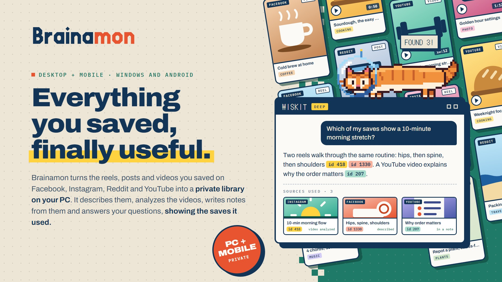](https://knackychan.github.io/brainamon/)

**Everything you saved, finally useful.**

Brainamon turns the reels, posts and videos you saved on Facebook, Instagram, Reddit and YouTube into a private library on your PC. It describes them, analyzes the videos, writes notes from them and answers your questions, showing the saves it used. Your library stays on your computer, and AI runs with your own key, only when you ask.

**[Presentation site](https://knackychan.github.io/brainamon/)** · [Download for Windows](https://github.com/knackychan/brainamon/releases/latest) · [Buy on Gumroad](https://fredtomas.gumroad.com/l/brainamon) · [Privacy policy](https://www.fredtomas.com/brainamon/privacy/)

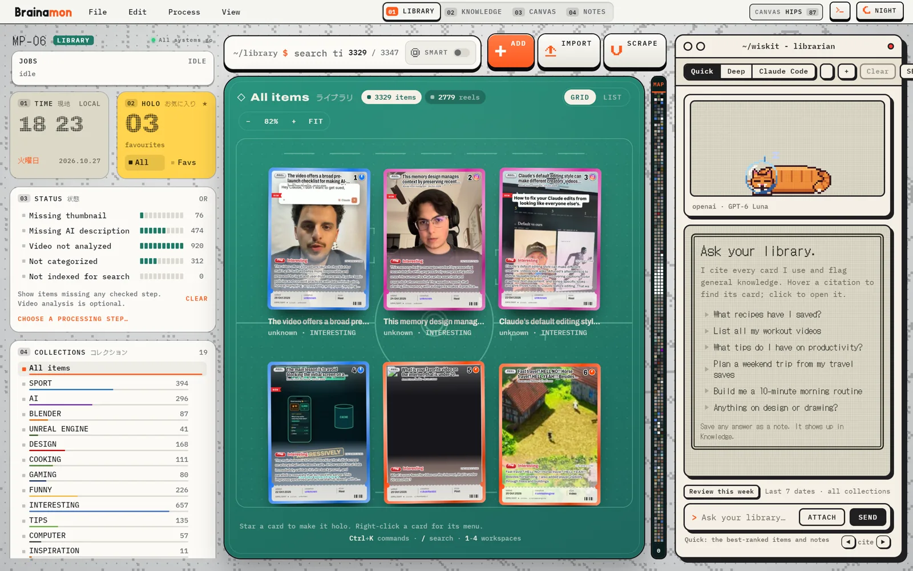

## Download

- **Windows 10 / 11:** [download the latest installer](https://github.com/knackychan/brainamon/releases/latest) or browse [all releases](https://github.com/knackychan/brainamon/releases). Run it and follow the setup prompts. Windows may show an unknown-publisher warning. Brainamon checks future updates against a signed release manifest and installs them only when you choose.
- **License:** the Windows app is a one-time purchase on [Gumroad](https://fredtomas.gumroad.com/l/brainamon). The receipt key is exchanged once for a permanent license key that unlocks phone sync with your PC. Other desktop features do not depend on it.
- **Android:** a companion app that pairs with your PC or works on its own. It is planned for Google Play; store availability is not yet established.

## What it does

### One library for every save

Import your saved lists with the built-in scrapers or a CSV, paste a link, or share from your phone. Each save becomes a card with its thumbnail, caption, creator and category. A status panel shows what is still missing, and one step fills it in: thumbnails, AI descriptions, categories, video analysis and the search index.

- **Smart search** mixes exact words with meaning, so "knee pain" also finds the mobility reel that never says it.
- **Fetch link info** reads the post or page and fills in a missing thumbnail or caption.
- **Batch processing** describes, categorizes, analyzes or indexes hundreds of saves in one run, with the count and cost shown before you start.

### Wiskit, the assistant that cites its sources

Ask "What tips do I have on productivity?" and Wiskit reads your saves, answers, and links each point to the card it came from.

- **Quick** gives fast answers from the best-ranked saves and notes.
- **Deep** researches the library: it searches, reads reports and compares.
- **Claude Code** uses your own Claude Code sign-in as a third engine.
- It can sort a batch of saves into your categories, propose a themed canvas, save an answer as a note, and review your week.
- **Wiskit proposes, you decide.** Nothing in your library changes until you click Apply.

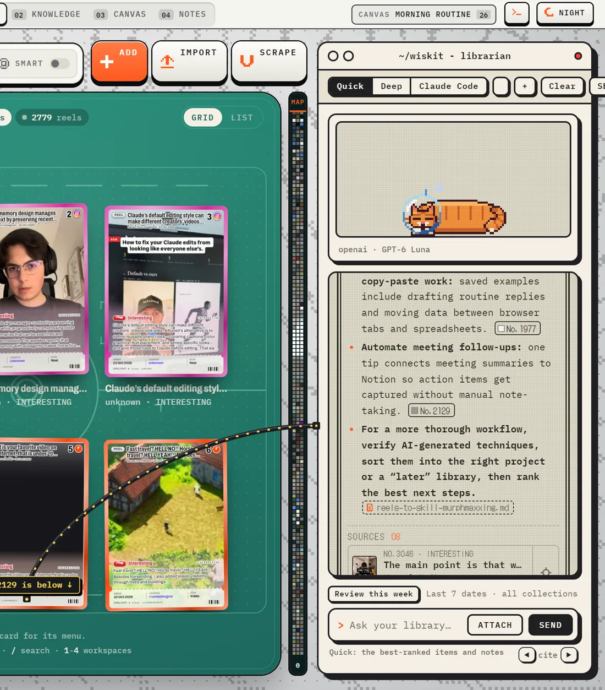

### Video analysis

Analyze video downloads the reel, pulls key frames, transcribes the audio and writes a report: the subject, the key information, a summary and how you could use it. The transcript and report stay with the save, ready for search and for Wiskit. Long videos are compressed and split for transcription automatically, and Video Tools can analyze a video file from your PC too.

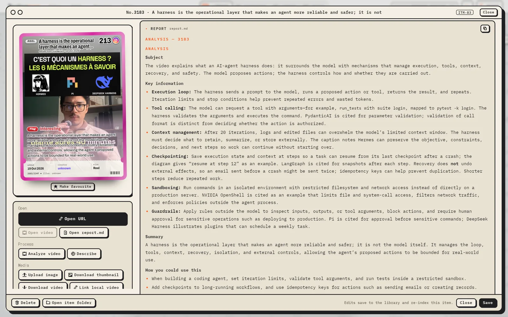

### Notes and knowledge

Pick a topic, tick the sources and press Synthesize: the AI reads them and writes one note that lists its sources. Connections watches what you save and points out topics that have no note yet. Topics you follow collect new saves for you, and everything is indexed so Wiskit reads your notes too.

My Notes is a calm editor with highlights, ink, tasks and stamps, plus voice notes transcribed to text and a Digest that reads a screenshot into a note.

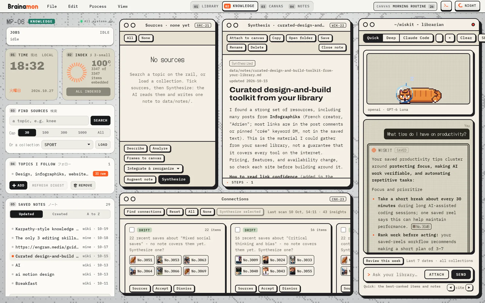

### Canvases

Drag saves, images and notes onto boards: a morning routine, a mood board, a project. Ask Wiskit for a themed canvas and it groups and arranges the cards for you to approve. Canvases open on the phone too.

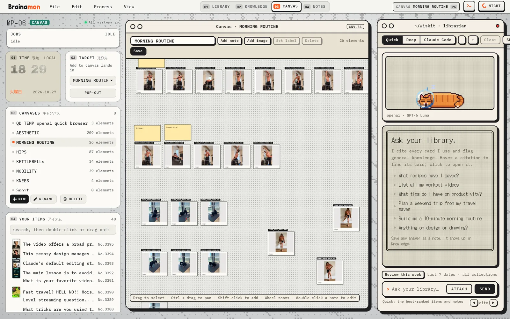

### Obsidian

Export to Obsidian writes your saves, categories, topics, reports and notes as linked Markdown files in a vault, so the graph view becomes a map of your library. Brainamon stays the source: the vault is rebuilt from your library on each export. Vault sync keeps an Obsidian vault on the phone up to date, encrypted through Drive.

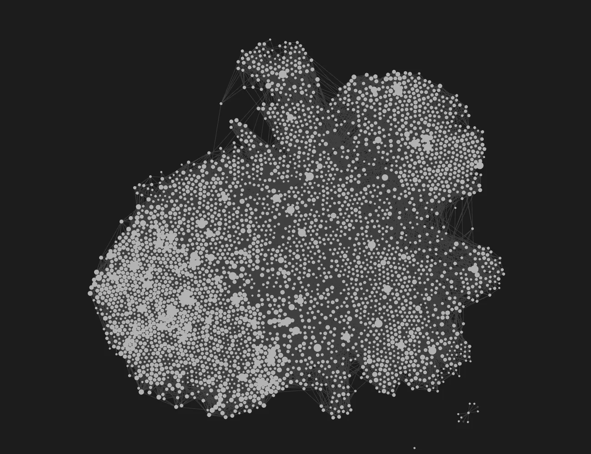

### Claude Code

Brainamon includes a local MCP server for Claude Code. Connect it and Claude can search your library, read items, reports, notes and canvases, and start jobs such as Describe or Fetch link info. Everything stays on your PC.

- No tool deletes, moves or overwrites anything.
- Notes, categories and canvases Claude proposes are applied only when you click in Brainamon.

### On your phone

The Android app takes the library with you: browse the cards, read reports and notes, open canvases and ask Wiskit with your own key. Share a link from any app and Brainamon keeps it as a draft until you press Save.

  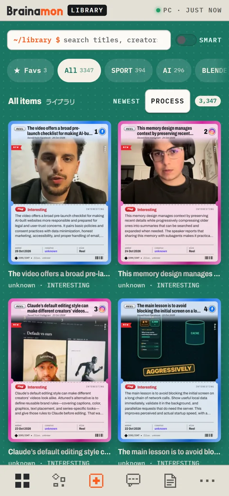
  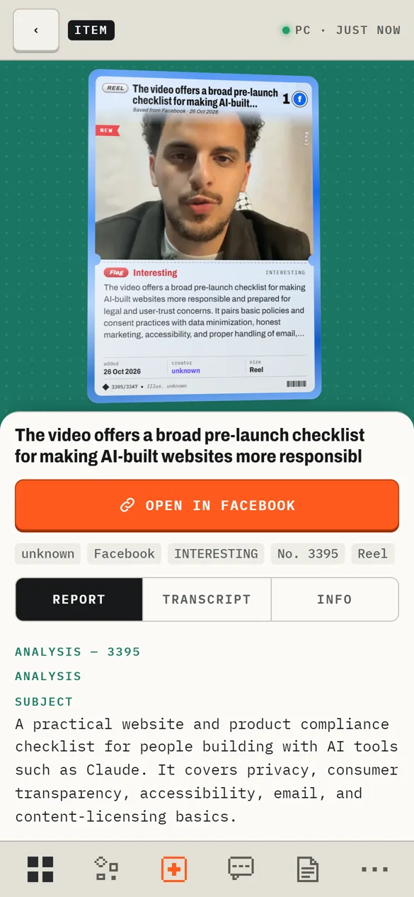
  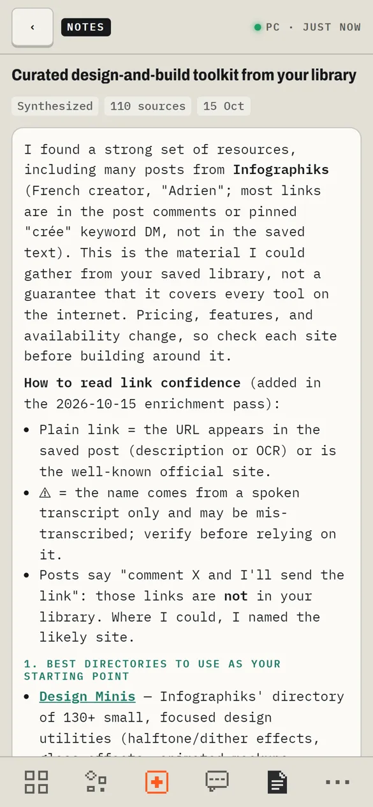
  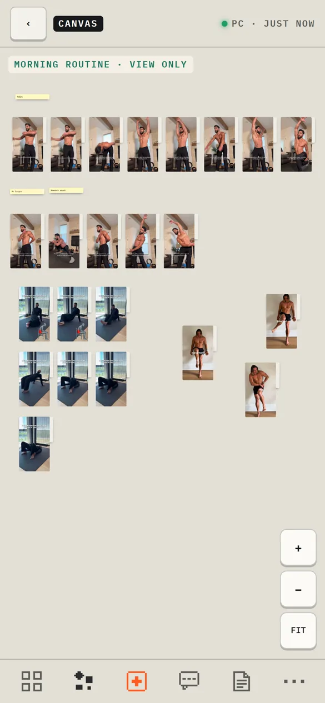

Phone sync goes through your own Google Drive: the PC encrypts the library (AES-256-GCM) and uploads it to Brainamon's hidden app-data folder, which cannot see your other Drive files. Only your paired devices hold the key. Sync is off until you turn it on, with no cloud call before that. Pair a phone by scanning a QR code on the PC. The app also works without a PC, with an optional encrypted backup, and Recovery lets you restore a library on a new PC. Phone sync requires a license and Google Drive.

### And more

- **Scrapers** capture your saved lists from your browser; Brainamon picks the file up from Downloads by itself.
- **Instagram export:** import the Saved file from your Instagram data download, on the phone.
- **Local models:** point Wiskit at a model running on your PC with Ollama or LM Studio.
- **Video downloads:** keep a copy of reels you care about, with logins you choose to add for private posts.
- **Desktop Wiskit:** start with Windows and wait in the tray, with Wiskit one click away.
- **Automatic updates:** new versions download in the background and are checked against a signature before you choose to install.
- **Day and night** themes on the PC and the phone.
- **Backup and restore:** your library is plain files and one database in a folder you choose.

## Private by design

Brainamon is local-first software. There is no Brainamon account, and your library never passes through a Brainamon server.

- Your library stays on your PC. No analytics and no automatic crash reports are sent to the developer.
- AI uses your own keys (Anthropic, OpenAI, or a model on your PC) and only when you ask. Provider charges are separate.
- API keys and site logins are protected with Windows DPAPI on the PC and Android Keystore on the phone.
- Drive sync is off by default and encrypted before upload.

Read the [privacy policy](https://www.fredtomas.com/brainamon/privacy/).

## Requirements and technical details

The installer requires an x64-compatible Windows PC and the Microsoft Edge WebView2 Runtime. Saving links and notes does not require an AI key. Optional video downloads and analysis may require separately installed tools such as yt-dlp and FFmpeg; AI providers may charge separately.

The desktop library uses a local SQLite database and files in your chosen data folder. The interface runs in WebView2 with a local server bound to `127.0.0.1`. Android uses a Capacitor app and Android Keystore. Keep a separate backup of your library and recovery information.

## Support

For support or privacy requests, contact [me@fredtomas.com](mailto:me@fredtomas.com).

The application source and support materials are maintained privately. This repository contains the public presentation site (`docs/`, published with GitHub Pages), the download page and release files.

Made by Frederic TOMAS.
